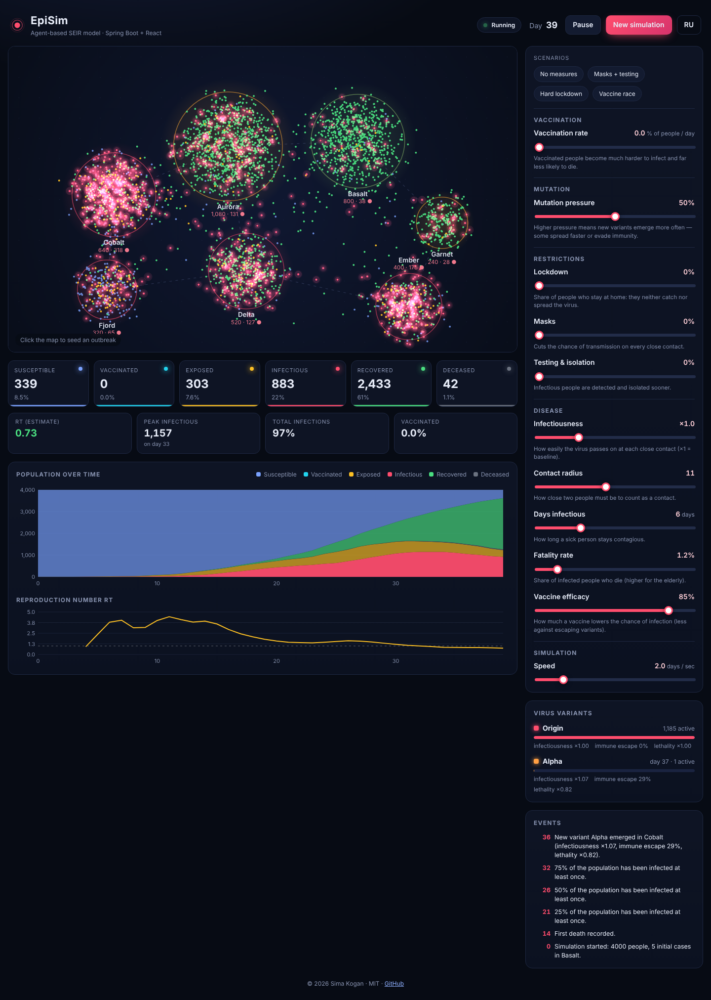

# EpiSim — agent-based epidemic simulator

A real-time epidemic simulator: a **Java / Spring Boot** backend runs an agent-based **SEIR** model and streams
every frame to a **React** frontend that draws a live map and charts on `<canvas>` (dark theme, animated).
Vaccination, virus mutations and restrictions can be changed with sliders **while the simulation is running**.



> Looking for something you can try without installing anything? See the lightweight browser-only sibling project, [OutbreakLab](https://simakogan.github.io/outbreak-lab/) ([source](https://github.com/SimaKogan/outbreak-lab)).

## Features

- **Agent-based SEIR(+V) model** — thousands of individual people (S → E → I → R / D), moving around 7 settlements
  and travelling between them; transmission happens between nearby agents (spatial hash grid, ~0.3 ms per tick).
- **Virus mutations** — new variants emerge during infections with their own infectiousness, lethality, incubation
  period and *immune escape* (reinfection waves!). A variant tree is shown live.
- **Vaccination** — vaccinated people are harder to infect (less so against escaping variants) and far less likely to die.
- **Restrictions** — lockdown (people shelter at home), masks, testing & isolation.
- **Tunable disease** — infectiousness, contact radius, infectious period, fatality and vaccine efficacy can all be changed live, so you can model anything from a mild flu to a deadly outbreak.
- **Live canvas UI** — smooth interpolated motion, glowing infectious agents, settlement heat colouring,
  stacked-area population chart with tooltip, Rt chart, events log, scenario presets, EN / RU switch.
- **Interactive** — click on the map to seed a new outbreak; pause / resume; start a new simulation with your own
  population size and number of initial cases.

## Architecture

```
┌──────────────── React (Vite) ───────────────┐        ┌──────────────── Spring Boot ────────────────┐
│ canvas map · charts · sliders · event log   │ ◄─SSE─ │ SimulationService (30 fps loop, 1 thread)    │
│ useSimulation hook (EventSource)            │ ─POST─►│ SimulationController  /api/sim/*             │
└─────────────────────────────────────────────┘        │ engine/Engine  (pure Java, no dependencies)  │
                                                       └──────────────────────────────────────────────┘
```

- `backend/…/engine` — the simulation itself. Pure Java, deterministic for a given seed, covered by unit tests.
- `backend/…/service` — owns one shared simulation; all engine access happens on a single thread, HTTP threads only
  enqueue commands; a separate sender thread pushes the *latest* frame so a slow browser never stalls the model.
- `frontend` — Vite + React. High-frequency data (agent positions) goes straight to the canvas through a ref;
  React state is refreshed at ~8 Hz for panels and charts.

### API

| Method & path            | Body (JSON)                                                                     | Purpose                         |
|--------------------------|----------------------------------------------------------------------------------|---------------------------------|
| `GET  /api/sim/stream`   | –                                                                                | SSE: `world`, `history`, `frame`|
| `POST /api/sim/params`   | any of `vaccinationRate` (0–3 %/day), `mutationRate`, `lockdown`, `masks`, `testing` (0–1), `speed` (0.5–10 days/s), `infectiousness` (0.3–3), `contactRadius` (4–20), `infectiousDays` (3–14), `fatality` (0–10 %), `vaccineEfficacy` (0–1) | live parameters |
| `POST /api/sim/pause`    | –                                                                                | pause                           |
| `POST /api/sim/resume`   | –                                                                                | resume                          |
| `POST /api/sim/reset`    | optional `population` (200–6000), `initialInfected`, `seed`                      | new simulation                  |
| `POST /api/sim/infect`   | `x`, `y` (world coordinates), optional `count`                                   | seed an outbreak                |

All viewers share one simulation.

## The model in brief

| Mechanism | Rule |
|-----------|------|
| Time | 8 ticks = 1 day |
| Contacts | an infectious agent can infect susceptible agents within the contact radius (11 units by default), per tick, with probability `base · infectiousness · variant β · susceptibility · mask factor` |
| Course | exposed ≈ 3 days → infectious (6 days by default) → recovered, or dead with probability `fatality · variant lethality · age risk` (×0.2 if vaccinated) |
| Immunity | recovery protects strongly against the same variant, weakly against others (depends on *immune escape*) and wanes over ~220 days; the vaccine efficacy slider (85 % by default) applies to the original variant |
| Mobility | agents roam inside their settlement and sometimes travel to another one (gravity-style choice) |
| Lockdown | a fixed random share of people shelters at home and neither infects nor gets infected |
| Testing | infectious people are detected with a daily probability and isolated at home |
| Mutation | every new infection may spawn a new variant with probability `mutationRate · 0.0004` (max 8 variants) |

Rt on the chart is an estimate: new infections per day × mean infectious period ÷ currently infectious.

## Run it

Requirements: **JDK 17+**, **Maven 3.9+**, **Node 18+**.

**Development (hot reload):**

```bash
# terminal 1 — backend on :8080
cd backend
mvn spring-boot:run

# terminal 2 — frontend on :5173 (proxies /api to :8080)
cd frontend
npm install
npm run dev
```

Open <http://localhost:5173>.

**Single jar (production):**

```bash
cd frontend && npm install && npm run build      # writes the bundle into backend/src/main/resources/static
cd ../backend && mvn package
java -jar target/episim-1.0.0.jar
```

Open <http://localhost:8080>.

**Tests:** `cd backend && mvn test`

## Project layout

```
backend/    Spring Boot app (engine · service · web) + unit tests
frontend/   Vite + React app (canvas map, charts, controls, i18n)
docs/       screenshot
```

## Ideas for next steps

- Age groups with school/work schedules, households and contact tracing
- Real geographic map (GeoJSON) and real travel data
- Persisting runs and comparing scenarios side by side
- Fitting model parameters to real case data

## License

MIT © 2026 Sima Kogan — see [LICENSE](LICENSE).
